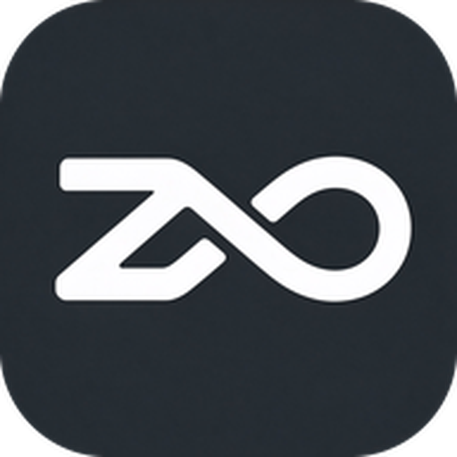

# Nezo

**常驻安卓的剪贴板收藏器 + 抖音/小红书/B站/快手解析下载工具。**

复制抖音、小红书等平台的「复制打开…」分享文案，Nezo 自动把它整理成卡片收进收件箱；
粘贴作品链接还能解析出图文/视频，按「下载所有图片 ZIP」「下载所有视频 ZIP」直接存到手机。

纯本地：收录内容只存在手机的应用私有目录，不联网、不上传；只有解析/下载作品时才联网。

<p align="center">
  
</p>

| 项目 | 值 |
|---|---|
| 应用名 | Nezo |
| 包名 | `com.ZenithLiteAura.app.nezo` |
| 版本 | 1.2.2（versionCode 9） |
| 要求 | Android 8.0+（minSdk 26，targetSdk 37） |
| 界面 | Kotlin + Jetpack Compose + MiUiX（HyperOS 液态玻璃风格） |

---

## 功能

### 剪贴板收录
- 应用在前台时自动监听，切回前台瞬间补抓（「在抖音复制 → 切回 Nezo」不会漏）
- 识别 8 个平台分享文本：抖音（新版/旧版/纯链接）、小红书、快手、B站、微博、YouTube + 兜底规则
- 收件箱：搜索、平台筛选、星标、按今天/昨天/更早分组、详情抽屉
- 识别规则可逐条开关，并可粘贴文本试解析

### 后台收录的三条真实通路
Android 10 起系统禁止后台应用读剪贴板，Nezo 提供三条能真正工作的路径：

| 通路 | 说明 |
|---|---|
| 分享到 Nezo | 抖音/小红书点「分享」→ 选 Nezo（零权限，最稳） |
| 悬浮球 | 授权悬浮窗后，任意界面点一下小球即收录 |
| Shizuku 后台监听 | 装 [Shizuku](https://shizuku.rikka.app/) 并用**无线调试**方式启动后，离开 App 也能收（需要 shell uid=2000，root 启动模式读不到剪贴板） |

> root 用户也可以安装 Magisk 模块（随 Release 提供）把 Nezo 装成系统应用，直接获得 `READ_CLIPBOARD_IN_BACKGROUND` 权限。

### 解析下载
- 输入作品链接或整段分享文案 → 解析 → 下载
- **下载所有图片 ZIP** / **下载所有视频 ZIP** / 逐个下载
- 命名规则 4 种（序号_标题 / 标题_清晰度 / 仅标题 / 仅序号），撞名自动 `_1`、`_2`
- 自动下载：关 / 仅图片 / 图片+视频，可限定仅 Wi-Fi
- 下载任务列表：等待排队、进度、取消、失败重试
- 文件落点：图片 `Pictures/Nezo/<标题>/`，视频 `Movies/Nezo/`，ZIP `Download/Nezo/`

平台支持：抖音 ✅、哔哩哔哩 ✅、小红书 ⚠️（需 App 内新复制、带 `xsec_token` 的链接）、快手 ⚠️（尽力而为）。

### 其他
- 前台服务常驻 + 通知栏入口；START_STICKY 与 `onTaskRemoved` 自恢复
- 导出 Markdown / TXT / CSV / JSON
- 深色模式；设置页采用 Nexio 式「图标 + 标题 + 二级页」结构
- **自动检查更新**：从本仓库的 Releases 检查新版本

---

## 安装

1. 下载 [Releases](https://github.com/ZenithLiteAura/Zeno/releases) 里最新的 `Nezo-<version>.apk`
2. 手机上允许「未知来源」后安装
3. 首次打开按需授予通知权限（悬浮球需额外授予悬浮窗权限）

---

## 自动更新

App 启动时静默检查本仓库的 `releases/latest`（24 小时内不重复请求），发现新版本会在设置 → 版本信息里显示；
也可手动点「检查更新」。更新走系统浏览器下载 APK，不静默安装。

---

## 构建

环境：JDK 21、Android SDK 37、Gradle 9.5.1（wrapper 已带）。

```bash
# 依赖走阿里云镜像（本机不能直连 Google Maven 时用得上）
./gradlew :app:assembleRelease

# 或者一键出包（含版本校验、badging、签名、内容体检）
powershell -ExecutionPolicy Bypass -File tools/build-apk.ps1
```

---

## 目录结构

```
Nezo/
├── app/                      Android 宿主：UI、服务、下载、Shizuku、更新检查
│   └── src/main/kotlin/com/ZenithLiteAura/app/nezo/
│       ├── ui/                Compose 界面（收件箱 / 下载 / 设置 / dock）
│       ├── platform/          前台服务、剪贴板、Shizuku、下载引擎、更新检查
│       └── data/              ClipRepo（收录数据）与下载契约
├── core/                     纯 Kotlin：规则引擎、存储、导出、抖音解析、命名/ZIP 规划
├── tools/                    构建 / 图标 / 安装 / Magisk 模块脚本
├── docs/                     图标预览
├── LICENSE                   AGPL-3.0
└── NOTICE.md                 第三方代码与致谢
```

---

## 致谢

| 项目 | 作者 | 说明 |
|---|---|---|
| [NexioSchedule](https://github.com/HaoZai000/NexioSchedule) | HaoZai000 | 底栏（dock）连续曲率胶囊与手势实现移植自该项目，整体视觉参考 |
| [MiUiX](https://github.com/compose-miuix-ui/miuix) | Yukonga | Compose 组件库 |
| [Shizuku](https://github.com/RikkaApps/Shizuku) | RikkaApps | shell 进程后台剪贴板 |
| [hellotik-douyin-clone](https://www.hellotik.app/) | — | 抖音分享页解析与图片 ZIP 链路协议参考 |

---

## 已知限制

1. Android 10+ 后台读剪贴板受系统限制，只能靠上面三条通路（Shizuku 需无线调试启动）。
2. 开机自启、后台常驻受国产 ROM 自启动/省电策略限制，需要手动加白名单。
3. 图片直链约 10 分钟过期，解析后请尽快下载；过期会提示重新解析。
4. 小红书需要 App 内新复制的分享链接；快手网页端常无作品数据。
5. 视频清晰度以平台返回为准，拿不到无水印地址时可能落到带水印版本。

---

## 协议

本项目以 **AGPL-3.0** 发布（因移植了 AGPL-3.0 项目的 dock 代码），详见 [LICENSE](LICENSE) 与 [NOTICE.md](NOTICE.md)。